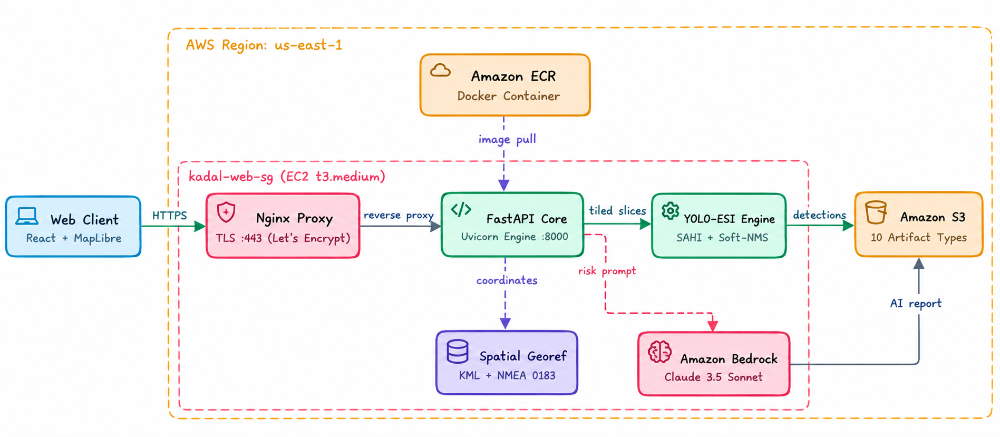

# KADAL: Kilohertz Acoustic Debris & Anomaly Localization
*Autonomous Edge AI for Marine Debris, Ghost Gear & Benthic Waste Localization in Side-Scan Sonar (SSS) Imagery*

<div align="center">

[](https://python.org)
[](https://fastapi.tiangolo.com)
[](https://reactjs.org)
[](https://www.typescriptlang.org)
[](https://onnxruntime.ai)
[](https://aws.amazon.com)
[](https://huggingface.co/Dinoman1221/sonarvision-yolov8-esi-v6)
[](LICENSE)
[](https://sdgs.un.org/goals/goal14)

**Autonomous Environmental Intelligence for Marine & Coastal Waste Management**  
*Real-time Edge AI for Benthic Plastic Debris, Ghost Fishing Gear, Sunken Obstacles, and Navigation Hazards in Ocean Acoustics.*

[Live Deployment (AWS HTTPS)](https://32.193.33.230.sslip.io) • [Hugging Face Model](https://huggingface.co/Dinoman1221/sonarvision-yolov8-esi-v6) • [Dataset](https://huggingface.co/datasets/Dinoman1221/sonarvision-multisource-v6) • [Quick Start](#quick-start) • [Architecture](#aws-cloud-architecture) • [Benchmarks](#empirical-benchmarks)

</div>

> **Results at a glance:** **0.6042 mAP50** on **962** held-out multi-sensor test images • **0 false alarms** on clean seabed • **5.9 MB** FP16 ONNX • **~2.4 ms** inference • trained on **100% real survey acoustics (zero synthetic renders)**.

---

## Live Production Deployment

* **Live Web Application (AWS HTTPS):** 👉 **[https://32.193.33.230.sslip.io](https://32.193.33.230.sslip.io)**
* **Compute:** AWS EC2 (`t3.medium`) with Nginx TLS reverse proxy (Let's Encrypt SSL)
* **Storage Lake:** Amazon S3 (`s3://kadal-marine-intelligence-071732232995`)
* **Ecological GenAI:** Amazon Bedrock (`anthropic.claude-3-5-sonnet-20241022-v2:0`)
* **Container Registry:** Amazon ECR (`071732232995.dkr.ecr.us-east-1.amazonaws.com/kadal:latest`)

---

## The Problem & Solution

**The Challenge:** Over 85% of marine plastic waste, discarded ghost fishing gear, and hazardous submerged obstructions sink to the ocean floor, completely invisible to optical satellites due to water opacity. Marine survey vessels rely on Side-Scan Sonar (SSS), but manual review of continuous acoustic waterfall logs takes days, bottlenecking cleanups.

**The Solution:** KADAL pairs a lightweight, attention-augmented deep learning model (**YOLOv8-ESI**) with AWS cloud services to detect, classify, and georeference submerged debris in real time:
1. **Highlight-Shadow Coupling:** Channel attention (SE) binds acoustic highlight reflections with corresponding acoustic shadows.
2. **Precision Geospatial Solver:** Solves embedded affine transform matrices (`EPSG:26916` $\to$ `WGS84`) to project bounding boxes into exact GPS coordinates.
3. **Automated Mission Operations:** Generates downloadable dive plans (`.kml`), NMEA 0183 navigation waypoints (`.txt`), publication-grade PDF dossiers, and cloud syncs 10 analytical artifacts directly to Amazon S3.
4. **Ecological AI Triage:** Leverages Amazon Bedrock (Claude 3.5 Sonnet) for automated Benthic Ecological Risk Assessments.

---

## AWS Cloud Architecture

<div align="center">
  
</div>

* **Amazon EC2 (`t3.medium`):** Runs the containerized FastAPI backend, ONNX Runtime inference engine, and Nginx reverse proxy with automated TLS termination.
* **Amazon ECR:** Securely hosts and delivers production Docker images.
* **Amazon S3 Data Lake:** Asynchronously archives 10 analytical artifacts per survey (original sonar, detection masks, colormaps, PDF dossiers, CSVs, JSON, KML, and NMEA waypoints).
* **Amazon Bedrock (Claude 3.5 Sonnet):** Assesses ghost-gear entanglement risks, seabed material density, and toxic degradation threats from target mensurations.
* **AWS IAM:** Enforces least-privilege instance profiles (`KadalEC2InstanceProfile`) for keyless cross-service authentication.

---

## Empirical Benchmarks

Evaluated on **962 independent held-out side-scan sonar test frames** with zero file overlap against train/validation splits (100% real survey data from NOAA, NATO CMRE MILCO, and Kaggle SSS):

| Object Type / Class | Benchmark Target | Baseline YOLO | **KADAL YOLOv8-ESI** | Precision | Recall |
| :--- | :---: | :---: | :---: | :---: | :---: |
| **Marine Debris** (`unknown_debris`) | $\ge 0.10$ | 0.0005 | **0.8185** | **81.9%** | **78.7%** |
| **Shipwreck** (`wreck`) | $\ge 0.70$ | 0.6698 | **0.7173** | **80.0%** | **60.4%** |
| **Naval Mine** (`mine`) | $\ge 0.30$ | 0.1833 | **0.3862** | **70.7%** | **29.6%** |
| **Submerged Aircraft** (`airplane`) | $\ge 0.70$ | 0.6206 | **0.4950** | **57.2%** | **69.2%** |
| **Overall Model mAP50** | $\ge 0.50$ | 0.3685 | **0.6042** (+64%) | **66.9%** | **62.4%** |
| **Clean Seabed False Alarms** | **0** | — | **0 False Alarms** | — | — |

* **Model Footprint:** 3.03M parameters | **5.9 MB** FP16 ONNX | **~2.4 ms** GPU inference (<45 ms edge ARM/x86 CPU).

---

## Quick Start

### 1. Clone & Run Locally
Prerequisites: **Python 3.10+** and **Node.js 20+**.

```bash
git clone https://github.com/sanjeevafk/kadal.git
cd kadal

# Launch unified application (FastAPI backend + React frontend)
./start.sh
```
Open **`http://localhost:8000`** in your browser.

### 2. Download Production Model & Data (Hugging Face)
```bash
# Model Weights (5.9 MB ONNX)
hf download Dinoman1221/sonarvision-yolov8-esi-v6 yolo_esi_v6_fp16.onnx --local-dir models/
cp models/yolo_esi_v6_fp16.onnx models/yolo_esi_fp16.onnx

# Multi-Sensor Acoustic Dataset (5,558 real sonar images)
hf download Dinoman1221/sonarvision-multisource-v6 sonarvision_multisource_v6.zip --repo-type dataset --local-dir datasets/
```

---

## Automated Intelligence Deliverables

Per survey pass, KADAL automatically produces:
* **Publication-Grade PDF Intelligence Reports:** Executive summaries, target badges, and annotated imagery.
* **Geospatial Tactical Plans:** WGS84 coordinates, Google Earth dive plans (`.kml`), and NMEA 0183 (`$GPWPL`) chartplotter waypoints.
* **Cloud Lake Artifact Sync:** Direct upload of 10 structured assets to Amazon S3 with presigned remote access URLs.
* **Structured Data:** Tabular CSV spreadsheets and machine-readable JSON feeds.
* **Operator Review Queue:** Real-time Confirm/Reject triage with persistent audit trails.

---

## Alignment with Global Environmental Goals

* **UN SDG 14: Life Below Water:** Directs ocean cleanup vessels to benthic plastic and ghost gear hotspots with meter-accurate coordinates.
* **Marine Habitat Preservation:** Safeguards coral sanctuaries, coastal fisheries, and navigable waterways from submerged hazards.

---

## Authors & Contributors

### Team Edge Runners
* **Sanjeev Kumar** (Team Lead)
* **Ashish**
* **Kamlesh Y**
* **Prajan**

---

## License & Acknowledgements
* Released under the **Apache 2.0 License** (see [LICENSE](LICENSE)).
* Real acoustic data sources: NOAA Hydrographic Survey Archives, NATO STO CMRE MILCO Benchmark, and Kaggle SSS Object Detection.
